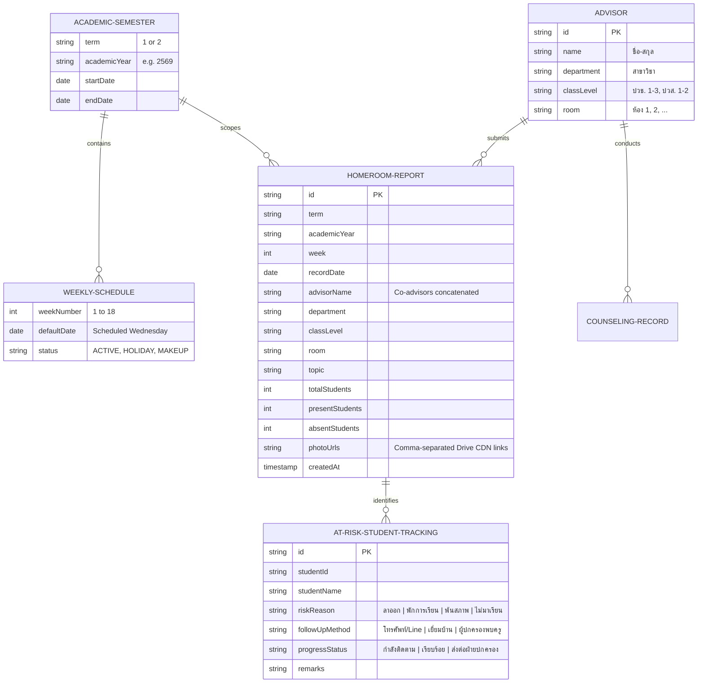

# Homeroom Activity & Counseling Tracking System
## Comprehensive System Architecture & Engineering Reference Guide

> **Document Version:** 2.0.0  
> **Target Environment:** Next.js 16 (App Router) • React 19 • TypeScript • Tailwind CSS v4  
> **Institutional Context:** Sukhothai Vocational College (วิทยาลัยอาชีวศึกษาสุโขทัย)  
> **Last Updated:** October 2026

---

## 1. System Overview & Core Concepts

### 1.1 High-Level Mission & Business Objectives
The **Homeroom Activity & Counseling Tracking System** is a mission-critical institutional web application developed for Sukhothai Vocational College. The primary goal is to digitize, streamline, and govern the weekly homeroom recording, student attendance monitoring, counselor interventions, and administrative reporting across all academic departments.

```
+---------------------------------------------------------------------------------------------------+
|                                 Sukhothai Vocational College                                      |
|                                Homeroom Activity & Counseling                                     |
+---------------------------------------------------------------------------------------------------+
                                                  │
             ┌────────────────────────────────────┴────────────────────────────────────┐
             ▼                                                                         ▼
   ┌────────────────────┐                                                    ┌────────────────────┐
   │  Advisor / Teacher │                                                    │   Administrator    │
   └─────────┬──────────┘                                                    └─────────┬──────────┘
             │                                                                         │
    • Weekly Homeroom Log                                                     • Advisor Directory
    • Real-time Photo Uploads                                                 • PIN-protected Audits
    • Student Attendance Stats                                                • College-wide Reports
    • Dropout / At-Risk Cases                                                 • Export 7 Standard
    • Counseling Intervention Records                                           PDF Formats
```

### 1.2 User Roles & Access Boundaries
1. **Advisors / Classroom Teachers (ครูที่ปรึกษา)**:
   - Record weekly homeroom sessions (Topic, Date, Week number, Total students, Present, Absent).
   - Capture or upload classroom activity photos directly from mobile devices or desktop.
   - Log individual and group student counseling records (แบบบันทึกการให้คำปรึกษา).
   - Track absent, suspended, and dropout-risk students (แบบติดตามนักเรียน นักศึกษา).
   - Preview and export official 7-part institutional PDF reports for their advisory classes.
2. **Administrative Staff / Department Heads (งานครูที่ปรึกษา / ผู้บริหาร)**:
   - Maintain the central advisor roster (Assigning teachers to Department, Class Level, and Room).
   - Enforce data integrity with security PIN verification for destructive operations (deleting reports or reassigning advisors).
   - Inspect overall compliance, generate college-wide term summaries, and export batch institutional records.

### 1.3 Core Domain Models
The core architecture models five interrelated administrative concepts:



---

## 2. Project Structure & Tech Stack

### 2.1 Complete Production Directory Tree
```text
c:\Project\homeroom\
├── app/                                 # Next.js App Router root
│   ├── actions.ts                       # Typed Server Actions (Google Sheets & Drive operations)
│   ├── favicon.ico
│   ├── globals.css                      # Tailwind CSS v4 directives & custom print media queries
│   ├── layout.tsx                       # Root HTML shell with font preloads (Sarabun)
│   ├── page.tsx                         # Root router redirecting to /record
│   │
│   ├── record/                          # Route: Homeroom Session Recording Form
│   │   └── page.tsx                     # Renders <HomeroomForm /> with report history
│   ├── report/                          # Route: College-wide Summary Dashboard
│   │   └── page.tsx                     # Renders <ReportView /> with semester filters
│   ├── print/                           # Route: Multi-Format PDF Report Center
│   │   └── page.tsx                     # Renders <FullReport /> (7 printable formats)
│   ├── advisor/                         # Route: Advisor Management & Class Assignments
│   │   └── page.tsx                     # Renders <AdvisorManagement /> (PIN protected)
│   │
│   └── api/                             # Serverless API Endpoints
│       ├── pdf/
│       │   └── route.ts                 # Puppeteer + @sparticuz/chromium PDF generator
│       └── image-proxy/
│           └── route.ts                 # High-speed CORS bypass proxy for Google Drive images
│
├── components/                          # Reusable Client & Server Components
│   ├── Navbar.tsx                       # App-wide navigation with active route highlights
│   ├── HomeroomForm.tsx                 # Core recording form, canvas compressor & history table
│   ├── AdvisorSelector.tsx              # Smart 3-tier dropdown (Dept -> Teacher -> Room)
│   ├── FullReport.tsx                   # Interactive on-screen A4 preview for 7 PDF form types
│   ├── ReportView.tsx                   # Analytical summary table with batch export actions
│   └── AdvisorManagement.tsx            # CRUD management table with inline security PIN modal
│
├── config/                              # Static configuration & academic schedules
│   ├── academicCalendar.ts              # Semester date boundaries & Week 1-18 mappings
│   └── constants.ts                     # System constants, departments, grade levels
│
├── lib/                                 # Shared utility libraries & service providers
│   ├── drive-utils.ts                   # Google Drive URL parser & CDN converter
│   ├── google-drive.ts                  # Apps Script Web App client bridge
│   ├── google-sheets.ts                 # google-spreadsheet driver & Auto-Healing engine
│   ├── schedule-mapping.ts              # Semester 2/2569 date-to-week lookup & unrecorded filter
│   └── pdf-templates/                   # Modular HTML template generators for PDF rendering
│       ├── coverTemplate.ts             # Template 1: หน้าปก
│       ├── tableTemplate.ts             # Template 2: ตารางบันทึกกิจกรรม
│       ├── photosTemplate.ts            # Template 3: ภาพกิจกรรมโฮมรูม (6 รูป/หน้า)
│       ├── counselingFormTemplate.ts    # Template 4: แบบบันทึกให้คำปรึกษา รายบุคคล
│       ├── counselingTableTemplate.ts   # Template 5: รายงานการให้คำปรึกษา (ตาราง)
│       ├── studentTrackingTemplate.ts   # Template 6: แบบติดตามนักเรียน ขาดเรียน/ไม่เข้าแถว
│       └── summaryFormTemplate.ts       # Template 7: สรุปปัญหาและข้อเสนอแนะ
│
├── types/                               # TypeScript domain definitions & Action contracts
│   ├── advisor.ts
│   ├── report.ts
│   ├── schedule.ts
│   ├── tracking.ts
│   └── actions.ts
│
├── public/                              # Static assets
│   ├── fonts/                           # Local Sarabun font files for offline Puppeteer rendering
│   │   ├── THSarabunNew.ttf
│   │   └── THSarabunNew-Bold.ttf
│   └── counseling-forms.html            # Standalone interactive offline-ready HTML counseling forms
│
├── .env.local                           # Private runtime credentials
├── package.json                         # Project dependencies & runtime scripts
├── tsconfig.json                        # Strict TypeScript compilation rules
├── tailwind.config.ts                   # Tailwind CSS configurations
├── APPS_SCRIPT_FIX.md                   # Google Apps Script deployment source (v3.0)
└── GEMINI.md                            # Comprehensive development log & activity history
```

### 2.2 Tech Stack & Key Dependencies
| Category | Technology | Version | Purpose |
|---|---|---|---|
| **Core Framework** | Next.js (App Router) | `16.1.6` | Hybrid Server Actions, streaming, serverless deployment |
| **UI Library** | React / React DOM | `19.2.3` | Client component rendering, canvas hooks, state management |
| **Language** | TypeScript | `^5.0` | End-to-end type safety, strict contracts |
| **Styling** | Tailwind CSS | `v4` | Contemporary UI styling, precise `@page` print styles |
| **Icons** | Lucide React | `^0.563.0` | Accessible SVG icon suite |
| **Primary Database** | Google Sheets API | `google-spreadsheet v5.0.2` | Zero-cost institutional database with real-time spreadsheet sync |
| **Auth** | `google-auth-library` | `^10.5.0` | Google Service Account JWT authentication |
| **Storage Engine** | Google Drive / Apps Script | Web App v3.0 | Cloud photo storage bypassing service account drive quotas |
| **PDF Rendering** | Puppeteer & Chromium | `puppeteer ^24.36` + `@sparticuz/chromium` | Pixel-perfect headless browser A4 PDF synthesis |

### 2.3 Database Schema Definitions

#### Implementation A: Current Google Sheets Architecture
The application coordinates data across dedicated worksheets inside a single central Google Sheet document:

1. **Sheet `Advisors`**:
   - Columns: `ระดับชั้น` | `ห้อง` | `สาขาวิชา` | `ครูที่ปรึกษา`
2. **Sheet `Reports`** (Master Log):
   - Columns: `id` | `term` | `academicYear` | `week` | `date` | `advisorName` | `department` | `classLevel` | `room` | `topic` | `totalStudents` | `presentStudents` | `absentStudents` | `photoUrl` | `timestamp`
3. **Subsheets `{term}/{academicYear}`** (e.g., `1/2569`, `2/2569`):
   - Duplicate slice matching the exact 15 columns of `Reports` partitioned per semester for auditing.

#### Implementation B: Production Relational DB Schema (Supabase / PostgreSQL DDL)
For high-scale or future database migration:

```sql
-- Enable UUID extension
CREATE EXTENSION IF NOT EXISTS "uuid-ossp";

-- 1. Advisors Table
CREATE TABLE advisors (
    id UUID PRIMARY KEY DEFAULT uuid_generate_v4(),
    name VARCHAR(255) NOT NULL,
    department VARCHAR(100) NOT NULL,
    class_level VARCHAR(50) NOT NULL,
    room VARCHAR(50) NOT NULL,
    created_at TIMESTAMP WITH TIME ZONE DEFAULT TIMEZONE('utc'::text, NOW()) NOT NULL
);

-- 2. Homeroom Reports Table
CREATE TABLE homeroom_reports (
    id UUID PRIMARY KEY DEFAULT uuid_generate_v4(),
    term VARCHAR(10) NOT NULL,
    academic_year VARCHAR(10) NOT NULL,
    week_number INTEGER NOT NULL CHECK (week_number BETWEEN 1 AND 18),
    record_date DATE NOT NULL,
    advisor_name VARCHAR(500) NOT NULL,
    department VARCHAR(100) NOT NULL,
    class_level VARCHAR(50) NOT NULL,
    room VARCHAR(50) NOT NULL,
    topic TEXT NOT NULL,
    total_students INTEGER NOT NULL DEFAULT 0,
    present_students INTEGER NOT NULL DEFAULT 0,
    absent_students INTEGER NOT NULL DEFAULT 0,
    photo_urls TEXT[] DEFAULT '{}',
    created_at TIMESTAMP WITH TIME ZONE DEFAULT TIMEZONE('utc'::text, NOW()) NOT NULL,
    CONSTRAINT unique_advisor_week_semester UNIQUE (class_level, room, department, term, academic_year, week_number)
);

-- 3. At-Risk & Dropout Tracking Table
CREATE TABLE student_tracking (
    id UUID PRIMARY KEY DEFAULT uuid_generate_v4(),
    report_id UUID REFERENCES homeroom_reports(id) ON DELETE CASCADE,
    student_code VARCHAR(50) NOT NULL,
    student_name VARCHAR(255) NOT NULL,
    reason VARCHAR(50) NOT NULL CHECK (reason IN ('ลาออก', 'พักการเรียน', 'พ้นสภาพ', 'ไม่มาเรียน')),
    follow_up_channel VARCHAR(50) NOT NULL CHECK (follow_up_channel IN ('โทรศัพท์/LINE', 'เยี่ยมบ้าน', 'พบผู้ปกครอง', 'หนังสือเตือน')),
    status VARCHAR(50) NOT NULL DEFAULT 'กำลังติดตาม' CHECK (status IN ('กำลังติดตาม', 'เรียบร้อย', 'ส่งต่อฝ่ายปกครอง')),
    remarks TEXT,
    created_at TIMESTAMP WITH TIME ZONE DEFAULT TIMEZONE('utc'::text, NOW()) NOT NULL
);
```

---

## 3. Data Flow & Integrations

### 3.1 Form Submission Lifecycle & Error Resilience Architecture

```
[ Client: HomeroomForm.tsx ]
       │
       ├─► 1. Client-side Image Compression (HTML Canvas, max 1200x1200px, 80% JPEG)
       │      (Prevents Vercel 4.5MB Server Action payload limit failure)
       │
       ├─► 2. Upload Photos via uploadPhotosAction (FormData)
       │      └─► POST to Google Apps Script Web App (base64)
       │          └─► DriveApp saves file & sets public permission
       │              └─► Returns high-speed CDN URLs (lh3.googleusercontent.com/d/FILE_ID)
       │
       ├─► 3. Save Homeroom Report via saveReportAction
       │      └─► Connects to Google Sheets via JWT
       │          ├─► Auto-Heal: Validates header row existence
       │          ├─► Appends row to 'Reports' master sheet
       │          └─► Resilient non-blocking backup to '{term}/{year}' subsheet
       │
       └─► 4. Typed Response Pattern { success: true } / { success: false, error: ... }
              └─► Replaces raw exceptions that cause Next.js production digest masking
```

#### Mitigating Next.js Server Component Digest Masking
In Next.js production builds, throwing raw `Error` objects across Server Action boundaries results in:
`"An error occurred in the Server Components render. The specific message is omitted in production builds..."`

To guarantee reliable feedback to teachers, the system enforces the **Result Object Pattern**:

```typescript
// types/actions.ts
export type ActionResult<T = void> = 
    | { success: true; data: T; message?: string }
    | { success: false; error: string; code?: string };

// app/actions.ts
export async function saveReportAction(
    report: Omit<HomeroomReport, 'id' | 'timestamp'>
): Promise<ActionResult<{ id: string }>> {
    try {
        await sheetService.connect();
        
        // Auto-combine co-advisors assigned to the same classroom
        const allAdvisors = await sheetService.getAdvisors();
        const matched = allAdvisors.filter(a =>
            a.classLevel === report.classLevel &&
            a.room === report.room &&
            a.department === report.department
        );
        if (matched.length > 0) {
            report.advisorName = matched.map(a => a.name).join(" และ ");
        }

        const id = await sheetService.saveReport(report);
        return { success: true, data: { id } };
    } catch (err: unknown) {
        const message = err instanceof Error ? err.message : "Unknown server error";
        console.error("[Action Error: saveReportAction]", err);
        return { success: false, error: message };
    }
}
```

---

### 3.2 Semester 2/2569 Schedule Mapping

Institutional homeroom sessions occur every **Wednesday** across the 18-week academic calendar. For **Semester 2/2569**, the system enforces an automated week-to-date calculation engine:

#### Pre-Configured Date Table (Weeks 1–18)
| สัปดาห์ (Week) | วันที่จัดกิจกรรม (Default Wednesday) | วันที่จัดกิจกรรม (รูปแบบไทย) | หมายเหตุ / กิจกรรมสำคัญ |
|:---:|:---:|:---:|---|
| **1** | `2026-10-21` | 21 ตุลาคม 2569 | เปิดภาคเรียนที่ 2/2569 / ปฐมนิเทศประจำชั้น |
| **2** | `2026-10-28` | 28 ตุลาคม 2569 | ติดตามการลงทะเบียนและค่าธรรมเนียมการศึกษา |
| **3** | `2026-11-04` | 4 พฤศจิกายน 2569 | การแต่งกายและระเบียบวินัยวิทยาลัยอาชีวศึกษา |
| **4** | `2026-11-11` | 11 พฤศจิกายน 2569 | การรณรงค์ป้องกันยาเสพติดและสิ่งมอมเมา |
| **5** | `2026-11-18` | 18 พฤศจิกายน 2569 | การวางแผนการเรียนและการทำกิจกรรมชมรม |
| **6** | `2026-11-25` | 25 พฤศจิกายน 2569 | วันสมเด็จพระมหาธีรราชเจ้า / กิจกรรมลูกเสือวิสามัญ |
| **7** | `2026-12-02` | 2 ธันวาคม 2569 | เตรียมความพร้อมกิจกรรมวันพ่อแห่งชาติ |
| **8** | `2026-12-09` | 9 ธันวาคม 2569 | ติดตามผลการเรียนก่อนสอบกลางภาค |
| **9** | `2026-12-16` | 16 ธันวาคม 2569 | **สัปดาห์สอบกลางภาคเรียนที่ 2/2569** |
| **10** | `2026-12-23` | 23 ธันวาคม 2569 | ประเมินผลการเรียนครึ่งภาคเรียน / แจ้งเตือน มส. |
| **11** | `2026-12-30` | 30 ธันวาคม 2569 | กิจกรรมส่งท้ายปีเก่าต้อนรับปีใหม่ / ปลอดภัยทางถนน |
| **12** | `2027-01-06` | 6 มกราคม 2570 | การเตรียมตัวสอบมาตรฐานวิชาชีพ / บันทึกความดี |
| **13** | `2027-01-13` | 13 มกราคม 2570 | กิจกรรมวันเด็กแห่งชาติและวันครู |
| **14** | `2027-01-20` | 20 มกราคม 2570 | การส่งเสริมการมีงานทำและการฝึกงาน (DVE) |
| **15** | `2027-01-27` | 27 มกราคม 2570 | ตรวจสอบเวลาเรียน 80% ก่อนสอบปลายภาค |
| **16** | `2027-02-03` | 3 กุมภาพันธ์ 2570 | การแก้กิจกรรมและส่งงานคั่งค้าง |
| **17** | `2027-02-10` | 10 กุมภาพันธ์ 2570 | ปัจฉิมนิเทศนักเรียนนักศึกษาที่สำเร็จการศึกษา |
| **18** | `2027-02-17` | 17 กุมภาพันธ์ 2570 | **สัปดาห์สอบปลายภาคเรียนที่ 2/2569** (สิ้นสุดภาคเรียน) |

#### Schedule Mapping Helper (`lib/schedule-mapping.ts`)
```typescript
export interface WeekSchedule {
    week: number;
    date: string;          // ISO Format YYYY-MM-DD
    thaiDate: string;      // 21 ต.ค. 2569
    notes?: string;
}

export const SEMESTER_2_2569_SCHEDULE: WeekSchedule[] = [
    { week: 1,  date: "2026-10-21", thaiDate: "21 ต.ค. 2569", notes: "เปิดภาคเรียนที่ 2/2569" },
    { week: 2,  date: "2026-10-28", thaiDate: "28 ต.ค. 2569" },
    { week: 3,  date: "2026-11-04", thaiDate: "4 พ.ย. 2569" },
    { week: 4,  date: "2026-11-11", thaiDate: "11 พ.ย. 2569" },
    { week: 5,  date: "2026-11-18", thaiDate: "18 พ.ย. 2569" },
    { week: 6,  date: "2026-11-25", thaiDate: "25 พ.ย. 2569" },
    { week: 7,  date: "2026-12-02", thaiDate: "2 ธ.ค. 2569" },
    { week: 8,  date: "2026-12-09", thaiDate: "9 ธ.ค. 2569" },
    { week: 9,  date: "2026-12-16", thaiDate: "16 ธ.ค. 2569", notes: "สอบกลางภาค" },
    { week: 10, date: "2026-12-23", thaiDate: "23 ธ.ค. 2569" },
    { week: 11, date: "2026-12-30", thaiDate: "30 ธ.ค. 2569" },
    { week: 12, date: "2027-01-06", thaiDate: "6 ม.ค. 2570" },
    { week: 13, date: "2027-01-13", thaiDate: "13 ม.ค. 2570" },
    { week: 14, date: "2027-01-20", thaiDate: "20 ม.ค. 2570" },
    { week: 15, date: "2027-01-27", thaiDate: "27 ม.ค. 2570" },
    { week: 16, date: "2027-02-03", thaiDate: "3 ก.พ. 2570" },
    { week: 17, date: "2027-02-10", thaiDate: "10 ก.พ. 2570" },
    { week: 18, date: "2027-02-17", thaiDate: "17 ก.พ. 2570", notes: "สอบปลายภาค" },
];

/**
 * Returns pre-mapped date for a selected week, or infers current week from local date
 */
export function getScheduleForWeek(weekNumber: number): WeekSchedule | undefined {
    return SEMESTER_2_2569_SCHEDULE.find(s => s.week === weekNumber);
}
```

---

### 3.3 Dynamic Week Filtering Algorithm
To prevent double-recording and assist teachers during busy grading cycles, the form automatically matches previous records and displays only **unrecorded weeks**.

```typescript
// lib/schedule-mapping.ts

/**
 * Filters the 18 semester weeks to only return weeks not yet submitted
 * by the selected classroom and advisor.
 */
export function getAvailableWeeks(
    allReports: HomeroomReport[],
    criteria: {
        term: string;
        academicYear: string;
        classLevel: string;
        room: string;
        department: string;
    }
): WeekSchedule[] {
    // 1. Identify weeks already recorded for this classroom in this semester
    const recordedWeeks = new Set(
        allReports
            .filter(r => 
                r.term === criteria.term &&
                r.academicYear === criteria.academicYear &&
                r.classLevel === criteria.classLevel &&
                r.room === criteria.room &&
                r.department === criteria.department
            )
            .map(r => Number(r.week))
    );

    // 2. Return remaining unrecorded weeks from the 18-week schedule
    return SEMESTER_2_2569_SCHEDULE.filter(s => !recordedWeeks.has(s.week));
}
```

---

### 3.4 Dropout & At-Risk Student Tracking Subsystem

The vocational education authority mandates proactive intervention for students displaying chronic absenteeism or academic disengagement.

```
+──────────────────────────────────────────────────────────────────────────────────+
|                    Dropout & At-Risk Student Tracking Matrix                    |
+──────────────────────────────────────────────────────────────────────────────────+
                                          │
       ┌──────────────────┬───────────────┴───────────────┬──────────────────┐
       ▼                  ▼                               ▼                  ▼
  [ ลาออก ]        [ พักการเรียน ]                   [ พ้นสภาพ ]       [ ไม่มาเรียน/ขาดแถว ]
  (Resigned)         (Suspended)                     (Dropped)          (Absenteeism)
       │                  │                               │                  │
       └──────────────────┴───────────────┬───────────────┴──────────────────┘
                                          │
                        Trigger Follow-up Action Protocol:
                                          │
              ┌───────────────────────────┼───────────────────────────┐
              ▼                           ▼                           ▼
       [ โทรศัพท์ / LINE ]           [ เยี่ยมบ้าน ]            [ พบผู้ปกครอง/เตือน ]
        Primary Contact              Home Visit               Formal Intervention
```

#### At-Risk Data Schema (`types/tracking.ts`)
```typescript
export type RiskReason = 
    | 'ลาออก'          // Student officially resigned
    | 'พักการเรียน'    // Formal academic leave/suspension
    | 'พ้นสภาพ'        // Dropped out due to attendance < 80% or missing credits
    | 'ไม่มาเรียน';     // Chronic unauthorized absences / skipping assembly

export type FollowUpMethod = 
    | 'โทรศัพท์/LINE'
    | 'เยี่ยมบ้าน'
    | 'พบผู้ปกครอง'
    | 'ส่งหนังสือเตือน';

export type FollowUpStatus = 
    | 'กำลังติดตาม'    // In Progress
    | 'เรียบร้อย'        // Resolved / Returned to school
    | 'ส่งต่อฝ่ายปกครอง'; // Escalated to Student Affairs Division

export interface StudentTrackingRecord {
    id: string;
    reportId?: string;
    studentCode: string;
    studentName: string;
    classLevel: string;
    room: string;
    reason: RiskReason;
    followUpMethod: FollowUpMethod;
    status: FollowUpStatus;
    remarks: string;
    updatedAt: string;
}
```

---

### 3.5 Database Auto-Healing & Resilience Engine (`lib/google-sheets.ts`)

To eliminate the recurring issue where manually created or newly generated semester tabs lack headers (which causes `_ensureHeaderRowLoaded` exceptions), the Google Sheets adapter implements an **Automated Header Healing Engine**:

```typescript
// lib/google-sheets.ts (Excerpt)

const REPORT_HEADERS = [
    'id', 'term', 'academicYear', 'week', 'date',
    'advisorName', 'department', 'classLevel', 'room',
    'topic', 'totalStudents', 'presentStudents',
    'absentStudents', 'photoUrl', 'timestamp'
];

async function ensureWorksheetReady(
    doc: GoogleSpreadsheet, 
    sheetTitle: string
): Promise<GoogleSpreadsheetWorksheet> {
    let sheet = doc.sheetsByTitle[sheetTitle];
    
    // 1. Create sheet if missing
    if (!sheet) {
        console.log(`[Auto-Heal] Worksheet '${sheetTitle}' missing. Creating...`);
        sheet = await doc.addSheet({ title: sheetTitle });
        await sheet.setHeaderRow(REPORT_HEADERS);
        return sheet;
    }

    // 2. Validate and auto-heal header row
    try {
        await sheet.loadHeaderRow();
        if (!sheet.headerValues || sheet.headerValues.length === 0) {
            throw new Error("Empty headers");
        }
    } catch {
        console.warn(`[Auto-Heal] Worksheet '${sheetTitle}' missing header row. Initializing headers...`);
        await sheet.setHeaderRow(REPORT_HEADERS);
    }

    return sheet;
}
```

---

### 3.6 PDF / Institutional Report Generation Pipeline

The institutional reporting suite generates 7 official print-ready document formats via server-side Puppeteer with embedded Sarabun fonts:

```
[ Print Request: /api/pdf ]
             │
             ├─► 1. Pre-fetch external Drive CDN images as Base64 URIs
             │      (Avoids Puppeteer headless navigation timeouts & cross-origin blocks)
             │
             ├─► 2. Compile Chosen HTML Template with Embedded TH Sarabun Font (@font-face)
             │
             ├─► 3. Launch Headless Chromium (@sparticuz/chromium in Vercel / Local Puppeteer)
             │      • Viewport: 1200 x 800
             │      • Format: A4 (210mm x 297mm)
             │      • printBackground: true
             │
             └─► 4. Stream application/pdf Buffer to Client
```

#### The 7 Institutional PDF Form Types:
1. **หน้าปก (Cover Page)**: Official title page with college seal, advisor name, academic semester, classroom designation, and academic year.
2. **ตารางบันทึกกิจกรรม (Activity Log Table)**: Paginated table (6 rows/page) recording weeks, dates, activity topics, student counts (Total, Present, Absent), and advisor signature lines.
3. **ภาพกิจกรรม (Photo Grid)**: 6 photos per page displayed in a balanced 2-column x 3-row layout with automated `(ต่อ)` page continuation numbering.
4. **แบบบันทึกการให้คำปรึกษา รายบุคคล (Individual Student Counseling Form)**: Comprehensive record capturing student details, behavioral problems, counseling recommendations, and parent contact.
5. **รายงานการให้คำปรึกษา ตาราง (Counseling Summary Table)**: Roster table listing all students who received advisory guidance across the semester.
6. **แบบติดตามนักเรียน ขาดเรียน/ไม่เข้าแถว (Absenteeism Tracking Table)**: Audit log capturing students at risk of dropout, absence reasons, and teacher intervention methods.
7. **สรุปปัญหาและข้อเสนอแนะ (Problems & Suggestions Summary)**: Interactive formal report concluding the semester with 4 institutional signature blocks (Advisor, Department Head, Deputy Director, Director).

---

## 4. Security & Deployment Best Practices

1. **Least-Privilege Secret Management**:
   - `GOOGLE_SERVICE_ACCOUNT_EMAIL` & `GOOGLE_PRIVATE_KEY` stored strictly in server-side environment variables.
   - `ADMIN_DELETE_PIN` required for any destructive record or advisor deletion.
2. **Image Proxy Security**:
   - `/api/image-proxy` enforces strict host allow-listing (`drive.google.com`, `lh3.googleusercontent.com`, `googleapis.com`), mitigating SSRF risks.
3. **Client-Side Canvas Payload Optimization**:
   - Images are downscaled to 1200px JPEG before form transmission, ensuring Server Action payloads remain well below Vercel's 4.5MB limit.

---
*End of Reference Guide. Standardized for Sukhothai Vocational College.*
